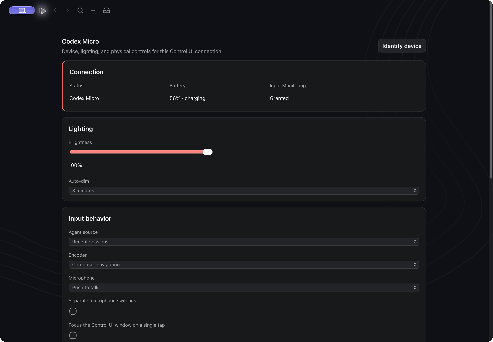

# Codex Micro for OpenClaw

Codex Micro adds conversation shortcuts, status lighting, physical controls,
a native composer bridge, settings, and local games to OpenClaw. It is a
macOS extension, not a standalone application.

The owner tested the physical Codex Micro in an earlier OpenClaw desktop build.
This source preview has not received a new physical-device acceptance run.
Individual voice and game-button combinations were not all separately verified;
this does not claim full Codex feature parity or exhaustive per-control testing.



## Host requirement

Codex Micro is a bundled OpenClaw plugin and requires the Control UI window,
external-link, composer-dictation, and connection-identity APIs included in this
source preview. Build it from the OpenClaw source checkout that contains those
APIs; no companion patch is required.

## Build and install

Use macOS and a supported OpenClaw development environment. From the source
checkout root, build and enable the bundled plugin:

```sh
pnpm install
pnpm build
pnpm openclaw plugins enable macropad
```

Open the authenticated Control UI. The plugin has no host configuration
fields. Layout, lighting, and device preferences are stored in OpenClaw's
plugin state and changed from the Micro settings page. The package remains
bundled with OpenClaw and is not a separate npm release.

## Controls and games

The six agent keys open their assigned conversations; a quick double press
focuses the native window. The encoder navigates the composer and opens
settings. The joystick bindings include Plan mode, forward, sidebar, and back.
Plan mode is unavailable on the current upstream session API and reports that
limitation without sending a session mutation. Other keys provide fast mode,
approvals, forks, dictation, and send. Settings support Recent, Pinned, Priority,
and custom slots, plus configurable key bindings.

Select **Games** above the composer to play Snake, Brick Breaker, or Asteroids.
Keyboard controls work without a connected Micro; joystick controls require a
connected device and focused composer. Games stop on focus, conversation, or
device changes.

## Permissions and limits

USB and Bluetooth HID access use macOS IOKit. Grant Input Monitoring to the
executable hosting the OpenClaw Gateway if macOS requires it, then reconnect
the device. The plugin does not flash firmware or write device files.

## Tests and notices

From the OpenClaw checkout root, run the backend tests with
`pnpm test:extension extensions/macropad`, the plugin UI tests with
`pnpm --dir ui test ../extensions/macropad/browser`, and build with
`pnpm --dir extensions/macropad build`. `LICENSE` retains OpenClaw's MIT terms;
`THIRD-PARTY-NOTICES.md` covers the SDK code bundled into the browser entry
and runtime dependencies.
